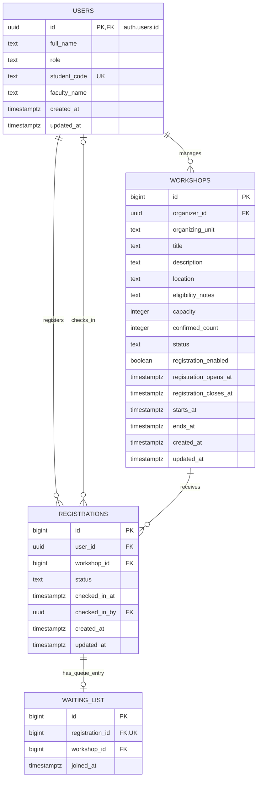

# ERD cơ sở dữ liệu WMS

- `users.student_code` bắt buộc với vai trò `student` và duy nhất khi có giá trị. `faculty_name` có thể để trống.
- `workshops.confirmed_count` do trigger cập nhật cùng giao dịch với đăng ký. Ràng buộc `0 <= confirmed_count <= capacity` cũng chặn việc giảm sức chứa thấp hơn số suất đã xác nhận.
- `registrations.checked_in_by` tham chiếu `users.id`. Một đăng ký đã điểm danh phải có cả thời điểm và người thực hiện, đồng thời ở trạng thái `confirmed`. Backend kiểm tra quyền điểm danh trên từng workshop.
- `waiting_list (registration_id, workshop_id)` là khóa ngoại ghép trỏ đến `registrations (id, workshop_id)`. Điều này giữ mục chờ thuộc đúng workshop. Thứ tự FIFO trong từng workshop là `joined_at, id`.
